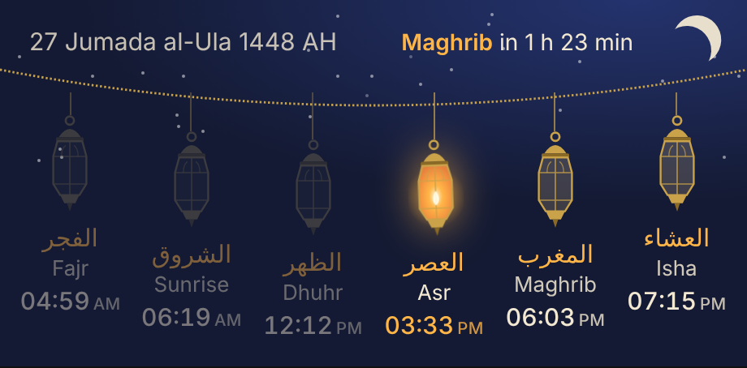
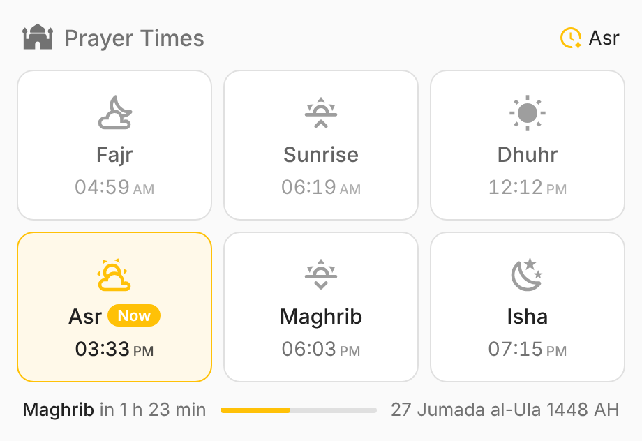
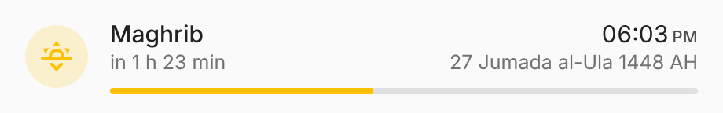
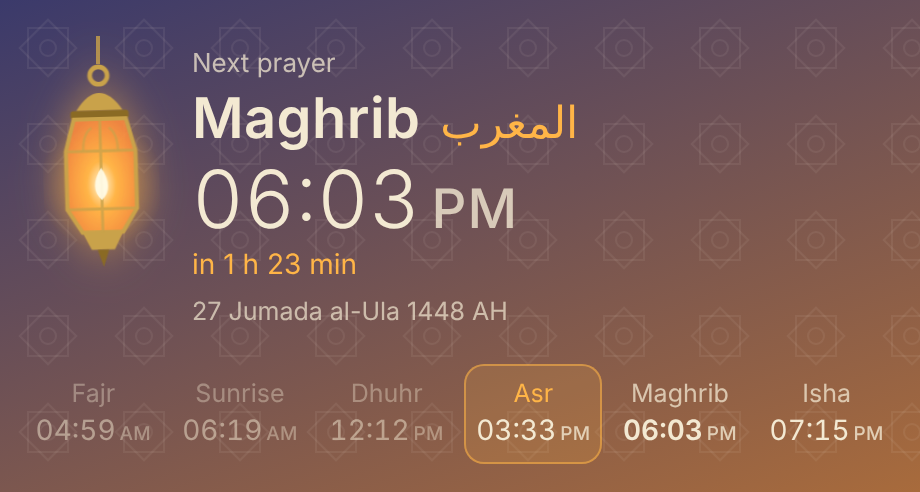
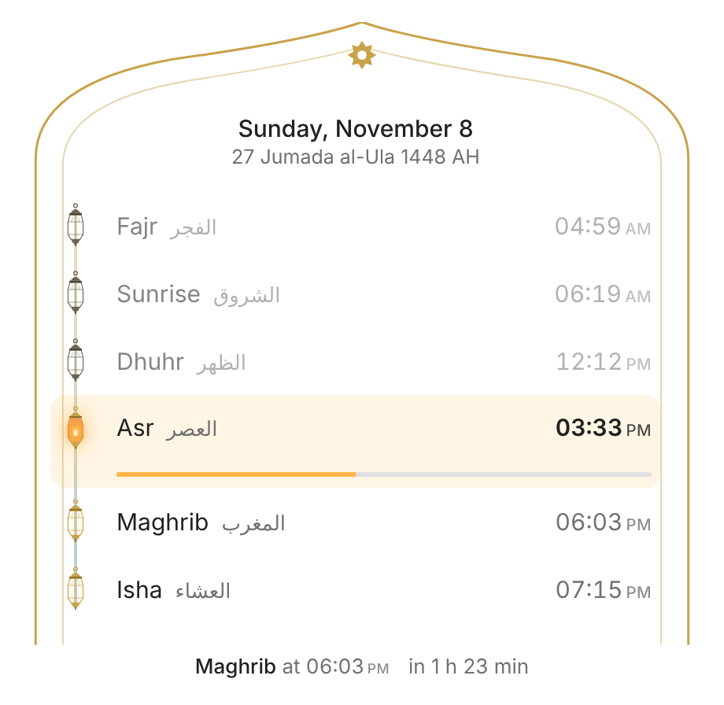
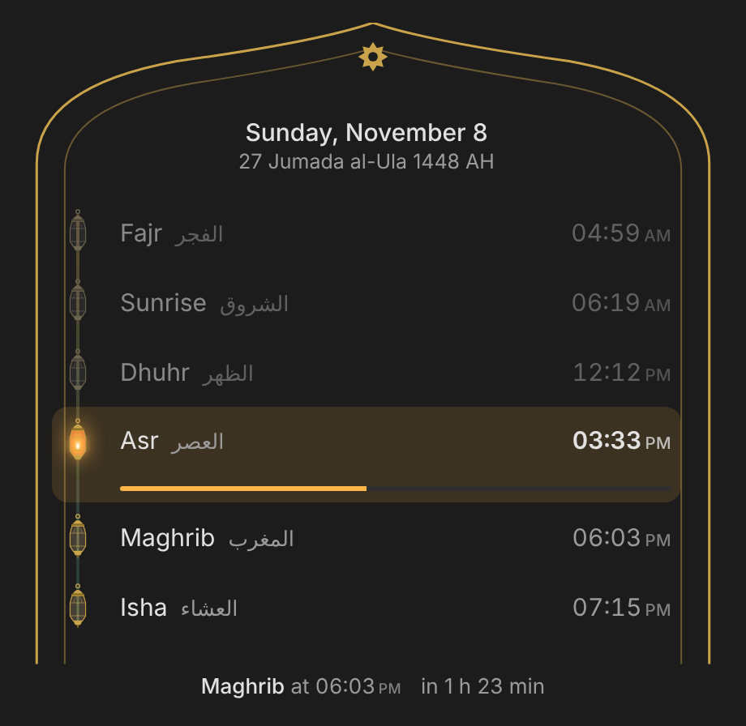

<p align="center">
  
</p>

<h1 align="center">Islamic Prayer Time for Home Assistant</h1>

<p align="center">
  Accurate, fully offline prayer times with per-prayer minute adjustments, any calculation method,
  your own location and elevation &mdash; plus five ready-made dashboard cards that install with it.
</p>

<p align="center">
  <a href="https://github.com/hacs/integration"></a>
  <a href="https://github.com/sariyamon/islamic-prayer-time-ha/releases"></a>
  <a href="https://github.com/sariyamon/islamic-prayer-time-ha/actions"></a>
  
</p>

<p align="center">
  
</p>

## Why this integration

The core *Islamic Prayer Times* integration calculates times well, but most mosques publish a timetable that differs from the raw calculation by a few minutes. The usual workaround is a template sensor per prayer &mdash; six helpers, plus another template to work out the current prayer, plus a dozen conditional cards on the dashboard.

This integration replaces all of that:

| | Core integration + templates | **Islamic Prayer Time** |
|---|---|---|
| Calculation engine | `prayer-times-calculator-offline` | **Same library, same defaults** &mdash; identical results |
| Mosque adjustments (± minutes) | One template helper per prayer | Built in, editable live from the dashboard |
| Current / next prayer | Hand-written template | Built-in sensors that flip at the exact minute |
| Countdown to next prayer | &mdash; | Built-in timestamp sensor + live card countdown |
| Custom location / elevation | HA home only | Home location **or** any coordinates, optional elevation |
| Change method at runtime | Options dialog only | Options dialog **and** select entity |
| Hijri date | &mdash; | Sensor with ±2 day moon-sighting adjustment |
| Automations | Time triggers on each sensor | `islamic_prayer_time_prayer` event at every prayer |
| Dashboard cards | Build your own | 5 cards bundled and registered automatically |
| Internet required | No | **No** |

## Installation

### HACS (recommended)

1. HACS → ⋮ → **Custom repositories** → add `https://github.com/sariyamon/islamic-prayer-time-ha`, type **Integration**.
2. Search for **Islamic Prayer Time**, download it, and restart Home Assistant.
3. **Settings → Devices & services → Add integration → Islamic Prayer Time**.

[](https://my.home-assistant.io/redirect/hacs_repository/?owner=sariyamon&repository=islamic-prayer-time-ha&category=integration)

### Manual

Copy `custom_components/islamic_prayer_time` into your `config/custom_components/` folder and restart.

> The cards are part of the integration. There is no separate frontend download and no dashboard resource to add.

## Configuration

Everything is set up from the UI. If the core *Islamic Prayer Times* integration is already configured, its method, school, high-latitude rule and midnight mode are pre-filled so you get the same times from the first minute.

| Setting | Default | Notes |
|---|---|---|
| Calculation method | Karachi | 23 methods: MWL, ISNA, Egypt, Umm al-Qura (Makkah), Gulf, Kuwait, Qatar, Dubai, Singapore, JAKIM, Kemenag, Diyanet, Russia, France, Tunisia, Algeria, Morocco, Portugal, Jordan, Tehran, Jafari, Moonsighting Committee |
| Asr school | Shafi'i | Hanafi gives a later Asr |
| High-latitude adjustment | Middle of the night | Only matters above about 48° |
| Midnight mode | Standard | Jafari uses sunset → Fajr |
| Location | Home Assistant home | Turn off to enter latitude, longitude and elevation |
| Use HA elevation | Off | Off gives results identical to the core integration |
| Offsets | 0 min | −60 … +60 min for Fajr, Sunrise, Dhuhr, Asr, Maghrib, Isha, Imsak, Midnight |
| Hijri adjustment | 0 days | −2 … +2 days for local moon sighting |

Change any of these later from **Configure** on the integration (calculation, location, adjustments), or directly from the device page: offsets are `number` entities and the method / school are `select` entities, so you can even put them on a dashboard. Changes apply instantly &mdash; no reload, no restart.

### Example: matching a mosque timetable

If your mosque calls Fajr 8 minutes before the calculated time and the other prayers a few minutes after:

| Prayer | Offset |
|---|---|
| Fajr | −8 |
| Sunrise | 0 |
| Dhuhr | +2 |
| Asr | +3 |
| Maghrib | +3 |
| Isha | +3 |

## Entities

Entity IDs follow the name you give the location (`Prayer Times` → `sensor.prayer_times_fajr`).

| Entity | Type | Description |
|---|---|---|
| `sensor.*_fajr`, `_sunrise`, `_dhuhr`, `_asr`, `_maghrib`, `_isha` | timestamp | Adjusted time today. Attributes: `calculated`, `offset_minutes`, `tomorrow` |
| `sensor.*_midnight` | timestamp | Islamic midnight |
| `sensor.*_imsak`, `_last_third` | timestamp | Disabled by default |
| `sensor.*_current_prayer` | enum | `fajr` … `isha`. Attributes: `started`, `ends` |
| `sensor.*_next_prayer` | enum | Next prayer. Attribute: `time` |
| `sensor.*_next_prayer_time` | timestamp | When the next prayer starts. Attribute: `schedule` |
| `sensor.*_hijri_date` | text | e.g. `27 Jumada al-Ula 1448 AH`, with `day`, `month`, `year`, `month_name_ar`, `holidays` |
| `number.*_<prayer>_offset` | config | Minute offset per prayer |
| `number.*_hijri_date_adjustment` | config | Hijri day adjustment |
| `select.*_calculation_method`, `_asr_school` | config | Change method and school at runtime |

## Cards

All cards discover the integration's entities automatically, follow your Home Assistant 12/24-hour setting, update their countdown every second and open the more-info dialog on tap. Each has a visual editor. If you have more than one location configured, pick it with `device:`.

<table>
<tr>
<td width="50%"><br><b>Tiles</b> &mdash; <code>custom:islamic-prayer-times-card</code><br>The familiar six-tile layout with the current prayer highlighted, plus a countdown bar.</td>
<td width="50%"><br><b>Compact</b> &mdash; <code>custom:islamic-prayer-compact-card</code><br>One row for the next prayer. Good for headers and phones.</td>
</tr>
<tr>
<td><br><b>Lantern Glow</b> &mdash; <code>custom:islamic-lantern-glow-card</code><br>A lit lantern over a sky that changes with the time of day.</td>
<td><br><b>Lantern Night</b> &mdash; <code>custom:islamic-lantern-night-card</code><br>Six lanterns on a garland; the current prayer's lantern is lit, past ones dim.</td>
</tr>
<tr>
<td><br><b>Lantern Arch</b> &mdash; <code>custom:islamic-lantern-arch-card</code><br>A mihrab arch framing a lantern timeline with progress through the current prayer.</td>
<td><br>Every card adapts to light and dark themes.</td>
</tr>
</table>

### Card options

```yaml
type: custom:islamic-prayer-times-card
title: Prayer Times        # tiles, night, arch
columns: 3                 # tiles: 2–6
accent: amber              # tiles, compact: any HA colour name or CSS colour
show_arabic: true          # lantern cards
show_sunrise: true
show_hijri: true
show_footer: true          # tiles: next-prayer countdown bar
time_format: auto          # auto | 12 | 24
show_ampm: true
device: <device id>        # only if you configured several locations
names:                     # optional label overrides
  dhuhr: Zuhr
  maghrib: Maghrib
entities:                  # optional manual entity mapping
  fajr: sensor.my_fajr
```

The cards also work with the core *Islamic Prayer Times* integration if this one is not installed.

## Automations

At every prayer time the integration fires `islamic_prayer_time_prayer`:

```yaml
event_type: islamic_prayer_time_prayer
data:
  prayer: maghrib          # fajr | sunrise | dhuhr | asr | maghrib | isha
  is_prayer: true          # false for sunrise
  time: "2026-11-08T12:33:00+00:00"
```

Play the adhan on a speaker:

```yaml
automation:
  - alias: Adhan
    triggers:
      - trigger: event
        event_type: islamic_prayer_time_prayer
        event_data:
          is_prayer: true
    actions:
      - action: media_player.play_media
        target:
          entity_id: media_player.living_room
        data:
          media_content_id: >-
            {{ 'media-source://media_source/local/adhan_fajr.mp3' if trigger.event.data.prayer == 'fajr'
               else 'media-source://media_source/local/adhan.mp3' }}
          media_content_type: music
```

Or remind ten minutes before, using the timestamp sensors directly:

```yaml
triggers:
  - trigger: time
    at:
      entity_id: sensor.prayer_times_next_prayer_time
      offset: "-00:10:00"
```

## Migrating from the core integration

1. Install this integration; it pre-fills your existing method and school.
2. Enter the minute offsets you had in your template helpers.
3. Compare the new sensors against the old ones for a day.
4. Point your dashboards and automations at the new entities (or use the bundled cards).
5. Remove the old template helpers and the core integration.

## How times are calculated

The integration uses [`prayer-times-calculator-offline`](https://github.com/cpfair/prayer-times-calculator-offline), the same library as the Home Assistant core integration, so with identical settings the results are identical to the minute. Nothing is fetched from the internet. Elevation, when enabled, is passed to the same PrayTimes algorithm and only affects Sunrise and Maghrib. Offsets are applied after calculation. The Hijri date uses the tabular (Kuwaiti) algorithm; use the adjustment to match local moon sighting.

## Development

```bash
pip install pytest-homeassistant-custom-component "prayer-times-calculator-offline>=1.0.3"
pytest
```

## Licence

MIT &copy; sariyamon
